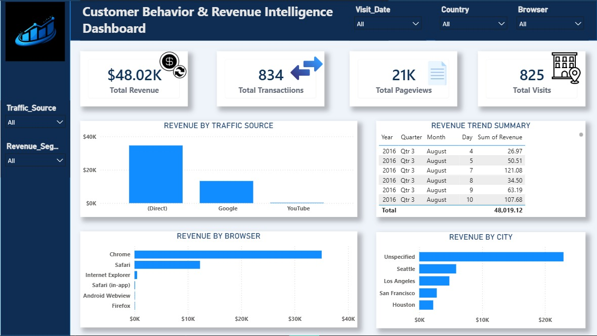
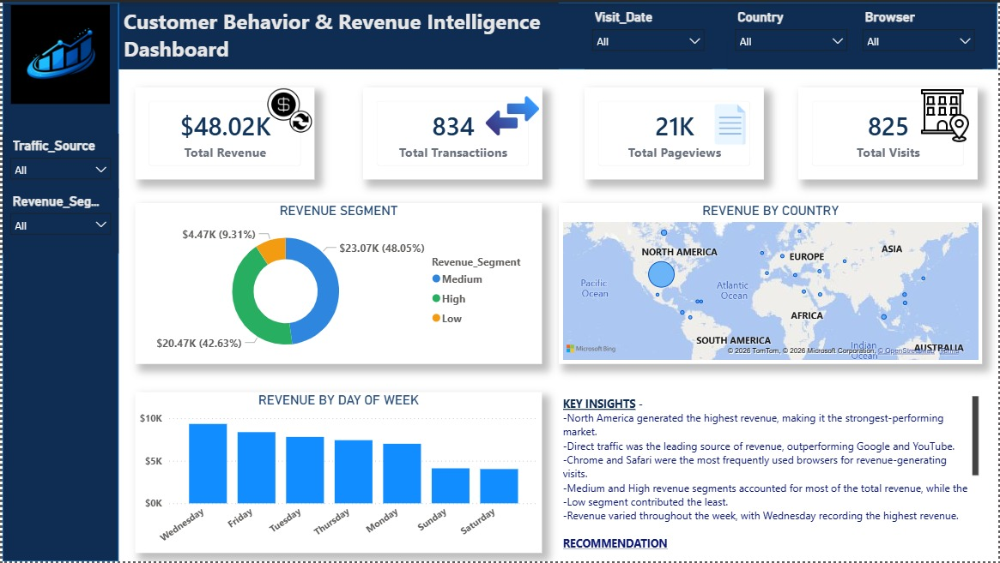

# E-Commerce Customer Behavior and Revenue Performance Analysis

## Project Overview

This project is an end-to-end business analytics case study examining website traffic, customer behavior, transaction performance, and revenue trends using Google BigQuery, SQL, Microsoft Excel, and Power BI.

The project follows a structured analytical workflow, from extracting and preparing data to analyzing performance, building interactive dashboards, and translating findings into business recommendations.

## Business Scenario

A retail business wants to understand its ecommerce performance across customer behavior, website traffic, transaction activity, and revenue generation.

Using website analytics data stored in BigQuery, the objective is to extract relevant information, identify meaningful patterns, and present insights that can support business reporting and decision-making.

## Project Objectives

- Extract relevant data from multiple BigQuery tables.
- Combine datasets using SQL.
- Clean and prepare data for analysis.
- Analyze revenue, transactions, pageviews, and traffic sources.
- Compare performance across countries, cities, browsers, and days of the week.
- Build interactive Power BI dashboards.
- Identify business trends and potential growth opportunities.
- Develop data-informed business recommendations.

## Tools and Technologies

- **Google BigQuery:** Data extraction and querying.
- **SQL:** Data filtering, combining, aggregation, and transformation.
- **Microsoft Excel:** Data exploration and analysis.
- **Power BI:** Interactive dashboards and business intelligence.
- **GitHub:** Project documentation and version-controlled portfolio presentation.

## Dataset

This project uses the Google Analytics Sample Ecommerce Dataset available through Google BigQuery.

The dataset contains information related to website sessions, geographic locations, devices, browsers, traffic sources, pageviews, transactions, and revenue.

### Key Dataset Fields

| Column | Description |
|---|---|
| `Visit_Id` | Website visit identifier |
| `Visit_Date` | Date of the website visit |
| `Country` | Country associated with the visit |
| `Clean_City` | Standardized city value |
| `Device_Category` | Device category |
| `Browser` | Browser used |
| `Traffic_Source` | Source of website traffic |
| `PageViews` | Number of pages viewed |
| `Transactions` | Transaction count |
| `Revenue` | Revenue recorded |
| `Revenue Category` | Revenue classification |
| `Conversion Flag` | Indicator of conversion status |

## SQL Analysis

SQL was used to extract, filter, combine, and prepare data for downstream analysis in BigQuery.

### SQL Concepts Applied

- `SELECT DISTINCT`
- `WHERE`
- `UNION ALL`
- `GROUP BY`
- Aggregate functions such as `SUM()`
- `CASE WHEN`
- `ORDER BY`
- `LIMIT`

### Main SQL Query

The main query selected relevant fields, applied filtering conditions, and prepared data for further analysis.


### Combining Data with UNION ALL

`UNION ALL` was used to combine query results from multiple tables with compatible column structures.


### SQL Results Preview

The query output provided the dataset used for further inspection, analysis, and Power BI dashboard development.


### Data Extraction and Filtering

The analysis combined Google Analytics session data from 2016 and 2017.

The extraction included filtering conditions related to:

- Revenue-generating sessions.
- Transactions greater than zero.
- Mobile users.
- Selected traffic sources.

`SELECT DISTINCT` was used to return distinct rows, and the final extraction was limited to 5,000 rows.

The row limit defines the scope of the extracted dataset and should be considered when interpreting the findings.

## Data Cleaning and Preparation

Data cleaning and preparation were performed before analysis and visualization to improve consistency and usability.

The documented cleaning steps included:

- Removing duplicate records where appropriate.
- Handling missing values.
- Standardizing city values.
- Converting revenue fields to appropriate data types.
- Filtering for valid transactions.
- Correcting date formats.
- Preparing fields for Power BI analysis.


## Excel Analysis

Microsoft Excel was used to explore the prepared dataset and examine patterns across:

- Revenue and transactions.
- Pageviews and traffic sources.
- Browsers and geographic locations.
- Revenue categories.
- Days of the week.

This analysis supported the identification of patterns and the preparation of business findings for the Power BI dashboards.

## Power BI Dashboard

The Power BI report provides an interactive view of ecommerce revenue, website activity, and traffic performance.

### Dashboard 1: Executive and Geographic Overview

**Key Performance Indicators**

| Metric | Result |
|---|---:|
| Total Revenue | $48.02K |
| Total Transactions | 834 |
| Total Pageviews | 21K |
| Total Visits | 825 |

**Key Visualizations**

- Revenue by category.
- Revenue by country.
- Revenue by day of the week.
- Geographic revenue distribution.
- Key business insights and recommendations.

### Dashboard 2: Traffic and Customer Performance

**Key Visualizations**

- Revenue by traffic source.
- Revenue trends over time.
- Revenue by browser.
- Revenue by city.
- Interactive filters for date, country, browser, traffic source, and revenue category.

## Dashboard Preview

### Executive and Geographic Overview



### Traffic and Customer Performance



## Key Business Findings

### 1. Geographic Revenue Performance

North America generated the highest revenue among the regions analyzed.

**Business implication:** Regional revenue patterns can help identify markets for further investigation. Comparing country-level transactions, conversion rates, and customer acquisition costs would provide additional context for marketing decisions.

### 2. Traffic Source Performance

Direct traffic was the leading revenue source in the analysis, outperforming Google and YouTube.

**Business implication:** Traffic sources should be evaluated using revenue, transaction volume, and conversion rates to understand their relative commercial value.

### 3. Browser Usage

Chrome and Safari were the most frequently used browsers among the visits analyzed.

**Business implication:** Browser-level performance monitoring can help identify potential usability or compatibility issues. Browser popularity alone does not establish which browser has the highest conversion rate.

### 4. Revenue Category Distribution

The Medium and High revenue categories accounted for most of the revenue, while the Low category contributed the least.

**Business implication:** Understanding how these categories are defined and how revenue is distributed across them can help inform customer segmentation and performance monitoring.

### 5. Revenue by Day of the Week

Wednesday recorded the highest revenue among the days analyzed.

**Business implication:** Comparing transaction counts, average transaction value, and website traffic across weekdays could help determine whether Wednesday represents a consistent opportunity for targeted campaigns.

## Business Recommendations

Based on the observed patterns, the following actions could be investigated:

1. **Evaluate traffic channels:** Compare Direct, Google, and YouTube using revenue, transactions, sessions, and conversion rates before adjusting marketing investment.
2. **Monitor browser performance:** Test website functionality across major browsers and investigate differences in usability or conversion performance.
3. **Investigate geographic opportunities:** Compare country-level revenue, transaction volume, and conversion rates before prioritizing regional campaigns.
4. **Explore weekday trends:** Examine whether Wednesday's higher revenue is consistent over time and assess whether targeted promotions would be commercially worthwhile.
5. **Review revenue categories:** Evaluate the definitions and characteristics of the Low, Medium, and High categories to identify appropriate business actions.
6. **Establish ongoing reporting:** Use interactive dashboards to monitor KPIs, investigate performance changes, and support regular business reviews.

## Analytics Workflow

The project followed the workflow below:

```text
Google BigQuery
       |
       v
SQL Data Extraction
       |
       v
Data Cleaning and Transformation
       |
       v
Excel Analysis
       |
       v
Power BI Dashboard Development
       |
       v
Business Insights
       |
       v
Business Recommendations
```

## Skills Demonstrated

- SQL querying and data extraction.
- Google BigQuery.
- Data cleaning and preparation.
- Exploratory data analysis.
- Ecommerce revenue and transaction analysis.
- Traffic source and geographic analysis.
- Power BI dashboard development.
- KPI reporting and data visualization.
- Business interpretation and recommendations.

## Project Limitations

The findings reflect the selected data, filtering criteria, and 5,000-row extraction limit. The results should not automatically be generalized to all website activity in the original dataset.

Traffic, revenue, and browser patterns describe observed associations rather than proven causes. Further analysis would be needed to validate the impact of proposed marketing or website improvements.

## About the Author

**DB-Analytics**

I am an Economics undergraduate at the University of Port Harcourt with an interest in Data Analytics, Business Intelligence, and Business Analytics. I use analytical tools to investigate business problems, identify meaningful patterns, and communicate insights that support informed decision-making.

**GitHub:** https://github.com/dbusiness-analytics

**LinkedIn:** https://www.linkedin.com/in/daniel-basil-60aa43363/

---

*This project demonstrates an end-to-end analytics workflow combining BigQuery SQL, Excel, and Power BI to investigate ecommerce performance and communicate business insights.*
